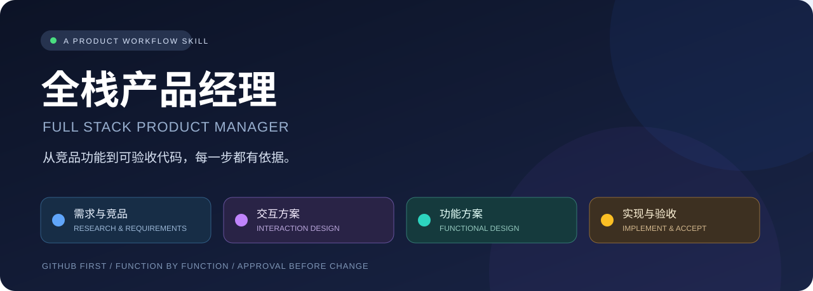
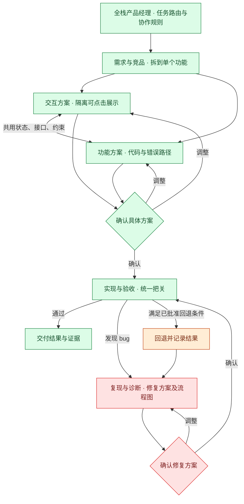

<div align="center">



<br />

[](skills/full-stack-product-manager/SKILL.md)
[](skills/full-stack-product-manager/modules/requirements-and-competitors/SKILL.md)
[](skills/full-stack-product-manager/SKILL.md)
[](LICENSE)

**先找到对应功能，讲清交互与实现，确认后再改。**

一个面向 **vibe coding** 的产品与开发协作 skill。<br />
把竞品证据、需求拆分、隔离交互展示、技术方案和最终验收串成可审阅的工作习惯。

[主 Skill](skills/full-stack-product-manager/SKILL.md) · [使用示例](examples/usage.md) · [自动触发规则](examples/AGENTS-snippet.md) · [验证说明](docs/validation.md)

</div>

---

## 🧭 为什么需要它

“做得像竞品”需要对应到具体功能；“修好了”需要实际验证；“顺手改一下”也可能带来范围外变更。

全栈产品经理把这些要求放进同一套流程：**先研究与核实，再提交可审阅方案，用户确认后实施，用证据验收。** 新功能、UI 调整、重构和每次 bug 修复都遵守同一套协作规则。

> 🟢 正常路径　🟠 回退 / 恢复路径　🔴 报错 / 停止路径<br />
> 每份交互、功能、修复方案都要有彩色流程图，颜色同时配文字标签。

## 🧩 四个模块，一套协作习惯

| 模块 | 负责什么 | 交付什么 |
| :--- | :--- | :--- |
| 🔵 **需求与竞品** | 定义需求、拆到单个功能、逐功能调研对应竞品 | 功能映射、证据、采用范围、验收标准 |
| 🟣 **交互方案** | 单个功能的 UI 与交互、隔离可点击展示、组件与样式复用 | 交互流程图、具体实现方案、确认后制作的展示 |
| 🟢 **功能方案** | 现有代码、实际行为、接口和数据、错误、冲突与回退 | 精细技术方案、具体改动位置、功能流程图、错误矩阵 |
| 🟠 **实现与验收** | 落实已批准方案、集成、代码/样式去重、验证与遗留管理 | 可验证实现、验收证据、bug 修复提案、遗留清单 |

主 skill 负责路由、确认、轮次与状态；四个内部子 skill 按需读取。默认由同一个 agent 执行，无需同时加载四套内容，也不会自动启动多 agent。



小任务按需选择入口：修 bug 不需要先做行业报告；纯后端功能不强制产出 UI；已有明确需求无需从头讨论。

## 🔎 竞品调研：按功能寻找对应实现

**① GitHub 开源项目 → ② 完全或高度一致功能的竞品 → ③ 相似类型竞品**

| 优先级 | 研究重点 | 判断边界 |
| :--- | :--- | :--- |
| 🥇 GitHub | 对应功能的源码、demo、文档、维护情况、适配成本、许可证 | 借鉴思路、复用实现、直接采用代码分别判断 |
| 🥈 同功能竞品 | 输入输出、权限、状态、限制、异常恢复等关键行为 | 不凭印象说“90% 一样”；说明具体覆盖与差异 |
| 🥉 相似类型竞品 | 可参考的交互或技术思路 | 标明局部适用范围，不冒充同功能竞品 |

一个功能形成一条可追踪关系：

```text
F01 用户需求
  → 对应竞品功能与证据
  → 相同 / 不同的行为
  → 本次采用范围与复用条件
  → 交互和功能方案
  → 验收结果
```

证据标记为 **亲测 / 源码核实 / 文档描述 / 推断 / 未验证**。证据足以支撑方案时就停止搜索，不为凑数量加入无关竞品。实时调研需要所在环境具备网络、浏览器或搜索能力；缺失时说明限制，不编造结果。

## 🖱️ 交互展示：单个功能，可点击，可对照

交互模块关注用户实际操作的完整过程，而不是默认制作整个产品原型。

- **按功能还原**：对照可验证的布局、文案、控件、状态转换和反馈。
- **隔离运行**：使用现有 sandbox、Storybook 或经确认的独立入口；样式和数据不污染主产品。
- **真正可操作**：核心控件可点击，支持复位、重复体验、关键异常状态。
- **说明能力边界**：模拟数据、真实接口、未观察行为、素材替代都明确标记。
- **检查复用**：组件、设计 token、状态逻辑和共享样式优先沿用已有实现。

> 🟣 展示本身也是代码。先确认展示实现方案，再创建展示；展示获批不等于正式集成获批。<br />
> “完全还原”以可访问且已验证的行为为依据，不对未观察行为作虚假承诺。

## 🛠️ 技术方案：具体到代码与失败节点

| 问题 | 需要给出的内容 |
| :--- | :--- |
| 当前怎么做？ | 文件、符号、调用链、数据流与实际证据 |
| 哪里需要改？ | 具体文件/函数、原因及新增/调整/删除范围 |
| 能复用什么？ | 现有工具、组件、状态、样式、错误处理 |
| 会产生什么冲突？ | 适用的接口、类型、权限、依赖、配置、迁移和并发边界 |
| 哪里可能失败？ | 沿流程逐节点检查合理失败模式与未覆盖项 |
| 失败后怎么办？ | 检测、错误类别、用户提示、诊断、重试、回退或终止 |
| 怎样证明完成？ | 正常/异常/恢复场景与对应验证方法 |

不会用一个通用 `catch` 代替错误分析，不无限重试，不用空结果冒充成功。业务降级、部分操作补偿和发布回滚分别设计；不存在合理回退时明确报错与恢复限制。

## 🚦 确认是流程门禁

**检查 → 具体方案 vN + 彩色流程图 → 用户确认 → 修改 → 验证**

- 只读探索、搜索、检查可以直接进行。
- 交付代码、样式、配置、依赖、测试、数据库结构和隔离展示写入前必须确认。
- “帮我做”“修一下”不等于批准尚未展示的方案。
- “确认 v2，按这个方案实现”批准的是已展示的 v2 及其明确范围。
- 已批准范围内的既定步骤连续执行；关键行为、接口、依赖、数据策略或范围变化时重新确认。
- **每次修 bug 都重新走流程**，包括实现或验收时发现的 bug，不直接顺手修。
- 同一问题连续 3 轮修正未解决，暂停尝试，重新诊断并讨论方案。
- 用户明确授权本次跳过确认时记录例外，不扩展为以后任务的默认许可。

方案批准不会自动授权发布、push、发送消息或生产数据操作。已有明确授权仍然有效。

## 📊 每次回复都有状态

```text
阶段：功能方案｜方案：v2，待确认｜代码：无，本次新增 0 / 任务累计 1 轮｜验证：部分通过｜遗留：1 项
```

| 字段 | 规则 |
| :--- | :--- |
| 阶段 | 当前在需求、交互、方案、实现、验收或修复的哪个环节 |
| 方案 | 版本与待确认/已确认状态；没有方案写不适用 |
| 代码有/无 | 自上一条面向用户的回复以来，是否修改实现文件 |
| 本次新增 | 自上一条回复以来新开始的修改轮数 |
| 任务累计 | 当前任务全部已开始的代码修改轮数，压缩上下文后保留 |
| 验证 | 未执行、部分通过、通过、失败或受阻，并说明对象 |
| 遗留 | 独立未解决问题数量；已知问题不能静默消失 |

**一轮 = 围绕一个明确目标的一批修改。** 多次工具写入可以属于同一轮；首次写入就计数。验证后再次修改、执行回退分别进入新轮。读文件、讨论、修改方案不计代码轮次。仅修改文档或 skill 指令时另报“文档/skill：有”。

## ⚡ 快速开始

### 1. 获取并安装到 Codex

需要 Git 和 Python 3。将完整 skill 文件夹复制到 Codex 的 skills 目录；不要只复制主 `SKILL.md`，它需要内部模块和模板。

```bash
git clone https://github.com/Jason12196/full-stack-product-manager.git

# 若已有安装，先比较内容，不直接覆盖。
python3 - <<'PY'
import os
import shutil
from pathlib import Path

source = Path("full-stack-product-manager/skills/full-stack-product-manager")
codex_root = Path(os.environ.get("CODEX_HOME", str(Path.home() / ".codex")))
target = codex_root / "skills" / "full-stack-product-manager"
if target.exists():
    raise SystemExit(f"已有安装，未覆盖：{target}")
target.parent.mkdir(parents=True, exist_ok=True)
shutil.copytree(source, target)
print(f"已安装：{target}")
PY
```

让客户端重新加载 skills；若列表未更新，重启客户端。安装只复制 skill，不自动修改你的全局规则、项目代码或依赖。

### 2. 显式调用

```text
$full-stack-product-manager
帮我设计文件上传功能，优先调研 GitHub 对应实现。
先检查已有代码，给方案和彩色流程图，等我确认后再实现。
```

中文显示名是 **全栈产品经理**，技术调用名是 **`full-stack-product-manager`**。

### 3. 按任务使用

| 你可以这样说 | 它应该怎么做 |
| :--- | :--- |
| “看看竞品这个功能怎么做” | 按功能调研并给证据，不开始实现 |
| “做个隔离可点击的展示” | 先给交互方案与图，确认后制作 |
| “实现这个明确的后端功能” | 核查现有代码，给功能方案，确认后实施 |
| “这个 bug 帮我修一下” | 先复现和诊断，再提交修复方案等确认 |
| “确认 v2” | 核实批准范围后实施，不重做整个调研 |
| “解释代码，别改” | 只读解释，不创建实现或方案文件 |

更多例子见 [使用示例](examples/usage.md)。

## 🎯 自动触发与适用范围

主 skill 的描述与 `allow_implicit_invocation: true` 支持自动发现。通常在以下任务触发：

🟦 产品需求与对应竞品调研　🟪 UI/交互调整　🟩 功能开发<br />
🟧 重构、运行配置与依赖变更　🟥 bug 与异常诊断/修复

同一任务的“继续”“确认”“这里有问题”延续已有状态，不重新加载全部模块。普通翻译、闲聊和非产品文档编辑不触发。

**自动发现是模型选择机制，不是程序级拦截器。** 若希望更稳定地遵守入口规则，可手动合并 [AGENTS.md 入口片段](examples/AGENTS-snippet.md)。本仓库不会自动修改它。

其他支持文件型 Agent Skills 的工具可尝试显式加载完整文件夹；自动发现与元数据解析取决于工具实现。本项目按 Codex skill 结构提供，未声称验证所有客户端兼容性。

## 🧠 上下文按需使用

主 skill 只保留路由和共同约束，细节在四个模块。功能 ID、状态、接口与证据共享，避免交互/技术重复定义。

小任务在会话完成；长任务按需保留一份精简状态，包含目标、验收、证据索引、批准范围、轮次、验证、遗留和下一步。未经允许不创建状态文件；不复制完整聊天、源码或日志。

省略重复叙述，但**不省略证据、确认、错误路径和验收**。

## 🗂️ 仓库结构

```text
full-stack-product-manager/
├── README.md
├── LICENSE
├── assets/banner.svg
├── examples/
│   ├── AGENTS-snippet.md
│   └── usage.md
├── docs/validation.md
├── scripts/validate.py
└── skills/full-stack-product-manager/
    ├── SKILL.md                    # 主 skill：路由与共同规则
    ├── agents/openai.yaml          # 中文显示名、调用示例与发现策略
    ├── references/templates.md     # 方案、状态与彩色图模板
    └── modules/
        ├── requirements-and-competitors/SKILL.md
        ├── interaction-design/SKILL.md
        ├── functional-design/SKILL.md
        └── implementation-and-acceptance/SKILL.md
```

四个内部模块随主 skill 一起安装，由主 skill 通过相对路径读取，不需要分别全局安装。

## ✅ 验证与改进

```bash
python3 scripts/validate.py
```

检查包结构、skill 元数据、内部链接和可移植性。行为验收场景与验证边界见 [验证说明](docs/validation.md)。结构校验不等于模型行为保证；首次在你的项目使用时，建议先用一个小功能验证确认点与输出习惯。

欢迎提交 issue 或 PR，最好附具体请求、预期行为、实际行为及脱敏证据。请勿提交密钥、私有源码或个人路径。

## 💡 参考与设计取舍

本项目参考以下开源工作流的设计理念，规则围绕本 skill 的协作目标重新编写：

- [Superpowers · Brainstorming](https://github.com/obra/superpowers/blob/main/skills/brainstorming/SKILL.md)：展示设计与批准范围。
- [Superpowers · Systematic Debugging](https://github.com/obra/superpowers/blob/main/skills/systematic-debugging/SKILL.md)：根因调查、最小修复与停止反复试错。
- [OpenSpec](https://github.com/Fission-AI/OpenSpec)：需求、设计与实施的阶段衔接，以及已有项目适配。
- [GitHub Spec Kit](https://github.com/github/spec-kit)：规范、方案、任务和实施的一致性。

没有绑定这些项目的工具链，也不要求额外安装它们。

---

<div align="center">

🔵 **先找依据**　·　🟣 **看清交互**　·　🟢 **确认方案**　·　🟠 **验证交付**

[MIT License](LICENSE) · Built by [Jason12196](https://github.com/Jason12196)

</div>
