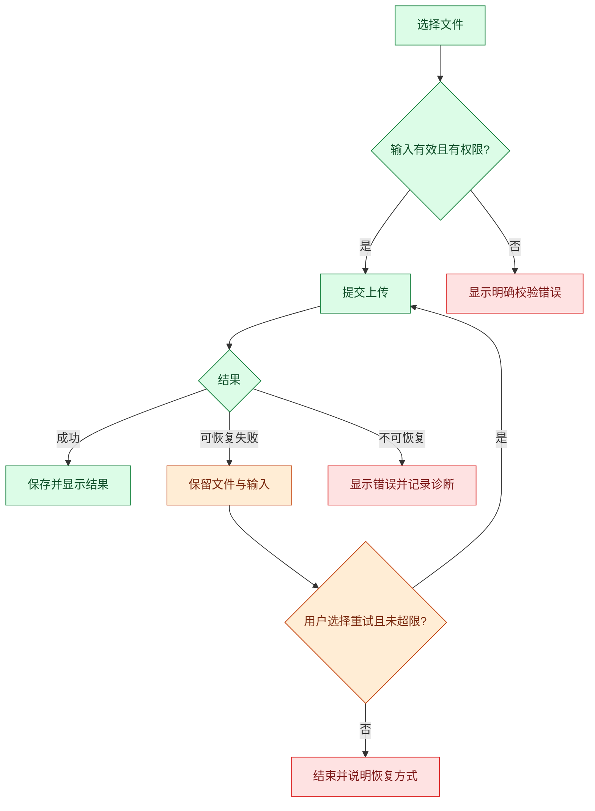

# 方案与状态模板

只读相关部分，小任务可简写。模板不代替具体证据。

## 功能卡

- ID / 功能名：
- 用户、场景、目标：
- 输入 / 输出 / 状态 / 权限：
- 对应竞品功能 / 来源 / 证据级别：
- 采用范围 / 差异 / 可复用条件：
- 验收场景 / 依赖 / 待决事项：

## 方案 vN

- 功能 ID / 类型：交互、功能、修复或组合
- 目标与验收：
- 当前实现与证据：具体路径、符号、来源
- 改动清单与复用：
- 冗余、冲突及适用边界：
- 交互状态 / 接口约束：按需
- 错误矩阵及回退：
- 流程图：
- 验证步骤与未覆盖项：
- 批准范围与待确认问题：

用户确认的是填好的具体方案，不是空模板。组合方案可以一次批准交互与功能范围，不能隐含批准未来未知修复。

## 图示示例：上传功能

下面仅是说明图，实际项目必须调整；不要默认添加重试。

绿色正常；橙色回退/恢复；红色报错/终止。每条异常路径用文字说明原因。进度回复只引用版本，不重复贴图。

## 任务状态（长任务按需）

- 任务目标 / 当前功能 ID / 阶段：
- 需求及验收摘要：
- 证据索引：链接或文件/符号，注明证据级别
- 当前方案版本 / 状态 / 明确批准记录 / 批准范围：
- 代码修改累计轮数 / 当前轮目标 / 是否已计数：
- 最近验证：对象、结果、证据与缺口
- 遗留问题：ID、影响、状态、下一步
- 用户约束与本次例外：
- 下一步与是否需要确认：

未知批准状态写“待核实”，不得补成已确认。状态不包含密钥、完整源码、日志或整段聊天。

## 每次回复状态栏

阶段：功能方案｜方案：v2，待确认｜代码：无，本次新增 0 / 任务累计 1 轮｜验证：部分通过（已复现，修复未执行）｜遗留：1 项

只修改文档时补充“文档/skill：有”；代码计数保持准确。
